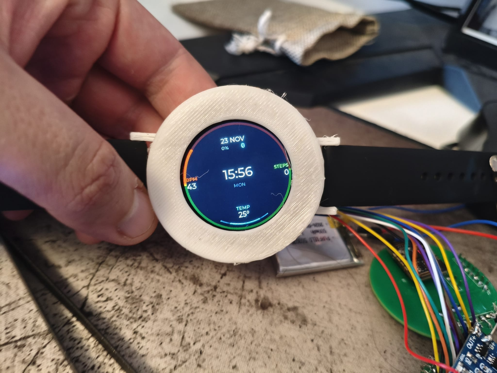

# ESP32-S3 Smartwatch

A DIY smartwatch built from scratch around the ESP32-S3-Zero, with custom PCBs, a round touch display running LVGL, health and environment sensors, and a custom Android companion app.

https://github.com/user-attachments/assets/e7bce69e-b9cd-4114-9a7d-c4fdbf5015b5

## Features

- Watch face with time, date, battery and BLE status
- Step counter, heart rate, altitude and temperature
- Phone notifications, music controls and run tracking over BLE
- Hebrew (right-to-left) text support
- Wake on wrist motion and swipe navigation

## Hardware

The electronics are split over two round 48 mm PCBs designed in KiCad (in [`hardware/`](hardware/)), and the case is a parametric OpenSCAD model (in [`case/`](case/)). 

## Firmware

Arduino on PlatformIO, with LVGL 8.3.11, LovyanGFX and NimBLE. The watch talks to the phone using the Gadgetbridge / Bangle.js JSON protocol.

To build: open the project in PlatformIO, select the `esp32-s3-zero` environment, then build and upload over USB.

## Companion app

A custom Kotlin Android app syncs the time, forwards notifications, controls music and receives run data. [github/co](https://github.com/KhlebD/watch_app)
